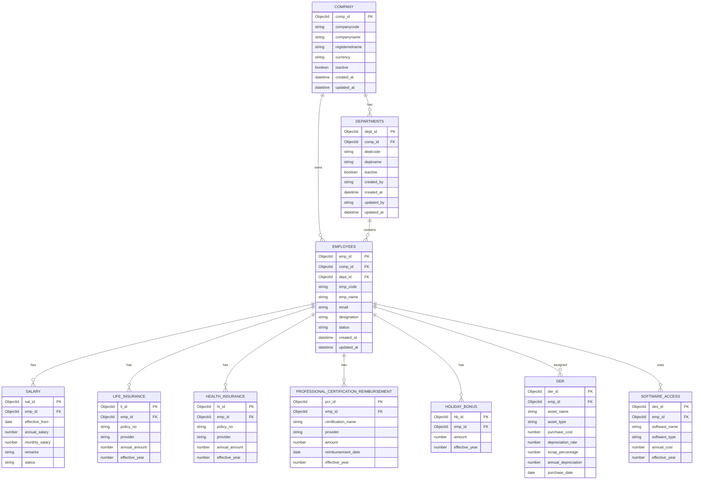
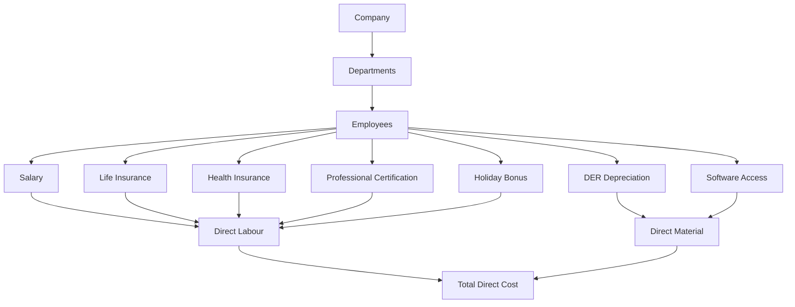
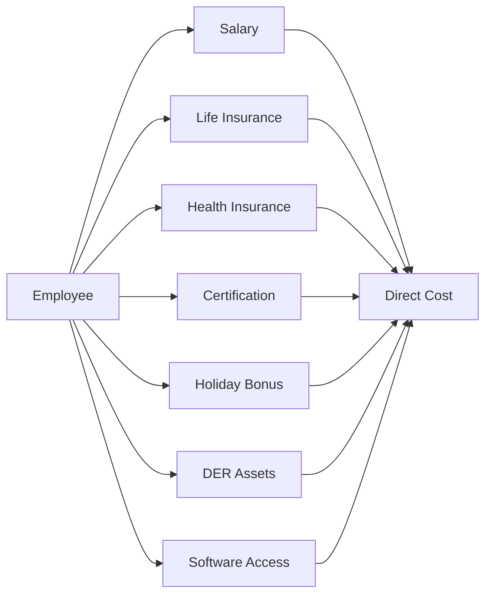

# Mermaid ER Diagram

---

# Relationship Matrix

| Parent | Child | Cardinality |
|----------|----------|----------|
| Company | Departments | 1 : Many |
| Company | Employees | 1 : Many |
| Department | Employees | 1 : Many |
| Employee | Salary | 1 : Many |
| Employee | Life Insurance | 1 : Many |
| Employee | Health Insurance | 1 : Many |
| Employee | Professional Certification Reimbursement | 1 : Many |
| Employee | Holiday Bonus | 1 : Many |
| Employee | DER Assets | 1 : Many |
| Employee | Software Access | 1 : Many |

---

# Direct Cost Data Flow

---

# Employee Cost Aggregation View

